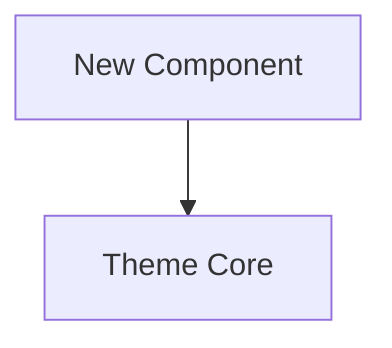

### 📌 Summary & Context / الملخص والسياق
*A clear and concise description of the proposed architectural enhancement or feature.*
*(وصف واضح وموجز للتحسين المعماري أو الميزة المقترحة لمنصة كود التطور).*

---

### 🎯 Objectives & Benefits / الأهداف والقيمة المضافة
- [ ] Benefit 1 / الفائدة الأولى
- [ ] Benefit 2 / الفائدة الثانية
- [ ] Performance or developer experience impact / أثر الأداء أو تجربة المبرمج

---

### 🏗️ Proposed Architecture & Design / التصميم والمعمارية المقترحة
*Describe the proposed component layers, modules, or APIs.*
*(وصف طبقات المكونات أو الوحدات أو واجهات الـ API المقترحة).*

---

### 🛡️ Security & Zero-Trust Considerations / اعتبارات الأمان والخصوصية
- [ ] Complies with Zero Host Code Execution policy?
- [ ] Zero client-side sensitive data leaks?
- [ ] Server-side validation and idempotency handled?

---

### 📋 Acceptance Criteria / معايير القبول
- [ ] Requirement 1
- [ ] Requirement 2