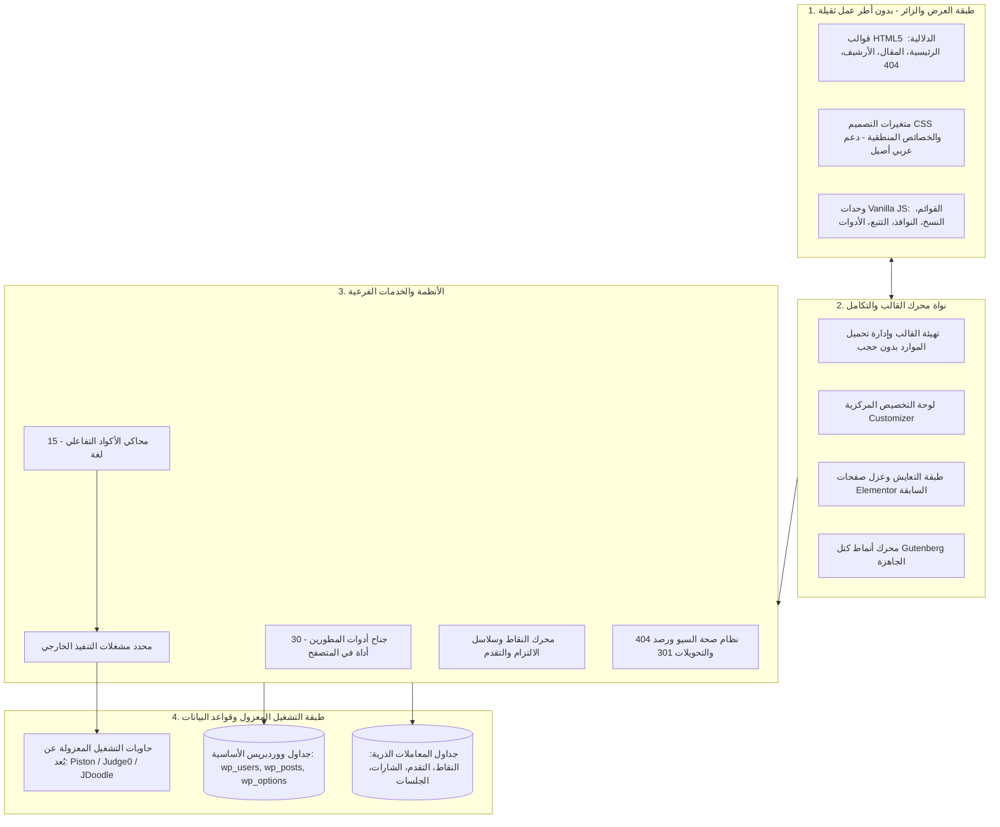

# كود التطور — توثيق معماري ودراسة هندسية لقالب WordPress المخصص

<p align="center">
  
  
  
  
  
  
  
  
</p>

> **توثيق معماري شامل ومعرض أعمال تقني**  
> *هندسة وتطوير: م. محمد أبو خشريف لصالح منصة كود التطور التعليمية.*  
> **المنصة الرسمية:** [https://code-elta6ur.com/](https://code-elta6ur.com/)  
> **موقع المطور التعريفي:** [https://mohammad.code-elta6ur.com/](https://mohammad.code-elta6ur.com/)  
> **حساب GitHub:** [https://github.com/mokashreef](https://github.com/mokashreef)  
> 🌐 **اللغة / Language:** [العربية](README.ar.md) | [English](README.md)

---

> [!IMPORTANT]
> **إشعار الملكية الفكرية والبرمجيات الخاصة (Proprietary & Closed-Source)**  
> هذا المستودع عبارة عن معرض أعمال تقني ودراسة حالة معمارية توثق التصميم الهندسي، ومجموعة التقنيات، ومعمارية التحزيم، ومنظومة التحقق الآلي الخاصة بقالب ووردبريس المطور حصرياً لصالح **منصة كود التطور**.  
> **الشيفرة المصدرية الأصلية للقالب، وملفات PHP، وملفات التنسيق والسكربتات، ومخططات قواعد البيانات، والأسرار التشغيلية هي ملكية خاصة تماماً ومستبعدة عمداً من هذا المستودع.**  
> لا يُمنح أي ترخيص بنسخ أو توزيع أو تعديل أو استخدام البرنامج الأصلي بموجب هذا المستودع. انظر [LICENSE](LICENSE) و [docs/ar/ownership-and-license.md](docs/ar/ownership-and-license.md).

---

## فهرس المحتويات
1. [الملخص التنفيذي وسياق المشروع](#1-الملخص-التنفيذي-وسياق-المشروع)
2. [حزمة التقنيات الشاملة والأدوات المستخدمة](#2-حزمة-التقنيات-الشاملة-والأدوات-المستخدمة)
3. [منهجية البناء وكيف تم التطوير خطوة بخطوة](#3-منهجية-البناء-وكيف-تم-التطوير-خطوة-بخطوة)
4. [معمارية النظام وتفكيك الطبقات الهندسية](#4-معمارية-النظام-وتفكيك-الطبقات-الهندسية)
5. [الأنظمة والأجنحة الوظيفية الرئيسية](#5-الأنظمة-والأجنحة-الوظيفية-الرئيسية)
   - [أ. جناح أدوات المطورين (30 أداة برمجية متخصصة)](#أ-جناح-أدوات-المطورين-30-أداة-برمجية-متخصصة)
   - [ب. محاكي الأكواد التفاعلي متعدد اللغات (15 لغة برمجة)](#ب-محاكي-الأكواد-التفاعلي-متعدد-اللغات-15-لغة-برمجة)
   - [ج. نظام العضويات والتحفيز وتتبع التقدم التعليمي](#ج-نظام-العضويات-والتحفيز-وتتبع-التقدم-التعليمي)
   - [د. جناح صحة الـ SEO وحماية حركة المرور والأرشفة](#د-جناح-صحة-الـ-seo-وحماية-حركة-المرور-والأرشفة)
   - [هـ. محرك أنماط كتل Gutenberg الجاهزة](#هـ-محرك-أنماط-كتل-gutenberg-الجاهزة)
6. [معمارية التحزيم الآلي وحزم التوزيع المزدوجة](#6-معمارية-التحزيم-الآلي-وحزم-التوزيع-المزدوجة)
7. [سجل الإصدارات التاريخية والمحطات الهندسية](#7-سجل-الإصدارات-التاريخية-والمحطات-الهندسية)
8. [منظومة التحقق المؤتمت والاختبارات وضمان الجودة](#8-منظومة-التحقق-المؤتمت-والاختبارات-وضمان-الجودة)
9. [معمارية الأمان الدفاعي وحماية الخصوصية](#9-معمارية-الأمان-الدفاعي-وحماية-الخصوصية)
10. [نطاق وحدود المستودع المعتمدة](#10-نطاق-وحدود-المستودع-المعتمدة)
11. [الملكية الفكرية وشروط الترخيص والاستخدام](#11-الملكية-الفكرية-وشروط-الترخيص-والاستخدام)
12. [بيانات الاتصال ونسبة العمل](#12-بيانات-الاتصال-ونسبة-العمل)

---

## 1. الملخص التنفيذي وسياق المشروع

**منصة كود التطور** ([code-elta6ur.com](https://code-elta6ur.com/)) هي صرح تعليمي عربي رائد متخصص في علوم الحاسوب وهندسة البرمجيات وتطوير الويب بمختلف مساراته.

مع نمو المنصة لتضم مئات المقالات التقنية و6 سلاسل برمجية متكاملة وآلاف الطلاب، واجه الموقع قيوداً شديدة نتيجة الاعتماد السابق على القوالب التجارية الجاهزة وبناة الصفحات الثقيلة (مثل Elementor):
- بطء ملحوظ في سرعة التحميل على الهواتف الذكية نتيجة تضخم ملفات JavaScript (jQuery, Bootstrap, React).
- تداخل عميق في شجرة عناصر الـ DOM (تصل إلى 15–20 حاوية متداخلة للقسم الواحد).
- غياب تايبوجرافي عربي أصيل موجه للمبرمجين العرب مع دعم الـ RTL المتوازن.
- تضارب الإضافات الخارجية وتعطيلها المستمر لميزات محاكي الأكواد وتتبع تقدم الطلاب.

لتجاوز هذا العبء التقني، تم اتخاذ قرار هندسي استراتيجي بإنشاء قالب ووردبريس مخصص بالكامل من الصفر (`code-elta6ur-theme`، الإصدار 1.2.5). القالب بمثابة تطبيق ويب متكامل فائق الخفة مدمج بذكاء داخل نواة ووردبريس، يعمل باستقلالية تامة وبدون أي أطر عمل ثقيلة في الواجهة، ليقدم أداءً قياسياً وتجربة تعليمية عربية استثنائية.

---

## 2. حزمة التقنيات الشاملة والأدوات المستخدمة

تم اختيار كل تقنية وأداة في المشروع بعناية فائقة لتحقيق التوازن بين السرعة والأمان وقابلية الصيانة طويلة الأجل:

```
┌────────────────────────────────────────────────────────────────────────┐
│                        مصفوفة التقنيات والأدوات المعتمدة                │
├────────────────────┬───────────────────────────────────────────────────┤
│ لغات البرمجة       │ • PHP 8.0, 8.1, 8.2, 8.3 (أنواع صريحة ومعايير WPCS)│
│                    │ • Vanilla JavaScript (ES6+ Modules، صفر jQuery)   │
│                    │ • Modern CSS3 (Grid, Flexbox, Custom Properties)  │
│                    │ • Semantic HTML5 (مطابق لمعايير WCAG 2.1 AA)     │
│                    │ • SQL (MySQL 8.0 / MariaDB عبر آلية dbDelta)      │
│                    │ • Bash / Shell للسكربتات وفحوصات الـ CLI          │
├────────────────────┼───────────────────────────────────────────────────┤
│ واجهات ونواة       │ • Customizer API (إدارة مركزية شاملة لكافة الإعدادات)│
│ ووردبريس الرسمية   │ • Rewrite API (مسارات مخصصة للأدوات /tools/ والمحرر)│
│                    │ • Transients & Object Cache API (أعلى كفاءة كاش)  │
│                    │ • dbDelta Database API (إنشاء الجداول المخصصة)     │
│                    │ • Block Patterns API (أنماط كتل Gutenberg الأصلية) │
│                    │ • WP-CLI Command API (أوامر سطر أوامر مخصصة للسيو)│
├────────────────────┼───────────────────────────────────────────────────┤
│ واجهات المتصفح     │ • IntersectionObserver API (التحميل الكسول والتحريك)│
│ الحديثة (Web APIs) │ • Page Visibility API (متتبع القراءة النشطة الفعلي) │
│                    │ • Clipboard API (نسخ الأكواد البرمجية بنقرة واحدة) │
│                    │ • Web Storage API (حفظ تفضيلات الأدوات في المتصفح) │
├────────────────────┼───────────────────────────────────────────────────┤
│ محركات تشغيل       │ • Piston Execution Engine Driver                  │
│ الأكواد المعزولة   │ • Judge0 API Driver                               │
│                    │ • JDoodle Cloud API Driver                        │
│                    │ • مشغل الأمان الاحتياطي (Null Execution Driver)   │
├────────────────────┼───────────────────────────────────────────────────┤
│ أدوات البناء       │ • مجمع التحزيم المخصص (build-theme-zip.php)        │
│ والتحقق والجودة    │ • مشغل الاختبارات المستقل (run-all-tests.php)      │
│                    │ • فاحص التوافق النحوي الشامل (lint-all-theme.php) │
│                    │ • فاحص التجاوب البصري المؤتمت (Node.js)           │
│                    │ • نظام إدارة النسخ Git مع معايير Conventional Commits│
└────────────────────┴───────────────────────────────────────────────────┘
```

---

## 3. منهجية البناء وكيف تم التطوير خطوة بخطوة

تم تنفيذ المشروع وفق دورة هندسية دقيقة من 5 مراحل منهجية:

### المرحلة الأولى: الفحص الميداني ونمذجة النطاق (Domain Modeling)
- فحص وتحليل أكثر من 370 مقالاً منشوراً، و6 سلاسل تعليمية، وسجلات الأخطاء التاريخية.
- إعداد فهرس شامل للروابط والمسارات لحمايتها من الكسر (`URL-INVENTORY.md`).
- صياغة المبادئ المعمارية الحاكمة: **انعدام أطر العمل الثقيلة، والنمطية التامة، وانعدام التنفيذ المحلي للأكواد**.

### المرحلة الثانية: بناء نظام التصميم ومحددات الهوية (Design Tokens)
- صياغة نظام تصميم موحد في `style.css` يرتكز على متغيرات CSS Custom Properties.
- تطبيق سياسة الهوية اللونية الصارمة بحظر اللون البنفسجي، واعتماد درجات الأزرق التقني والسماوي (`#0170B9`, `#3EA3E8`, `#004A7D`, `#3B82F6`, `#38BDF8`).
- بناء كامل شبكات الواجهة بالاعتماد على **الخصائص المنطقية** في CSS (`margin-inline`, `padding-inline`, `inset-inline`) لتوفير دعم عربي أصيل (RTL) وثنائي الاتجاه دون الحاجة لملفات CSS مضاعفة.

### المرحلة الثالثة: هندسة المحركات والأنظمة الفرعية (Subsystems)
- تطوير مهيئ القالب (`functions.php`) ومجلد التضمينات المنظم (`inc/`).
- بناء **جناح أدوات المطورين الـ 30** بالاعتماد على المعالجة من جانب العميل لضمان حماية خصوصية بيانات المستخدمين.
- تطوير **محاكي الأكواد التفاعلي** بنمط المشغلات المعزولة عبر واجهة `CDT_Execution_Driver_Interface`.
- بناء **نظام التحفيز والعضويات** بـ 4 جداول مخصصة أُنشئت عبر `dbDelta` ومحمية بمفاتيح منع تكرار العمليات (Idempotency).
- بناء **جناح صحة السيو** مع الرصد الفوري لأخطاء 404 ومحرك التحويلات 301 وأوامر WP-CLI.

### المرحلة الرابعة: التعايش السلمي وعزل الصفحات القديمة (Coexistence)
- بناء غلاف حماية ذكي (`compatibility.php` و `elementor-compat.css`) يعزل صفحات Elementor السابقة داخل كلاسات محددة، مما يضمن عرضها السليم دون تشويه الصفحات الجديدة المبنية بكتل Gutenberg الخفيفة.

### المرحلة الخامسة: التحقق المؤتمت وبناء حزم الإنتاج (Packaging & QA)
- تطوير مشغل الاختبارات التلقائي المستقل الذي يتحقق برمجياً من سلامة كافة الأدوات واللغات وقواعد الأمان.
- بناء مجمع التحزيم الآلي المزدوج وتدقيق سلامة الأرشيفات الناتجة عبر فاحص الحزم.

---

## 4. معمارية النظام وتفكيك الطبقات الهندسية

ينتظم القالب في 4 طبقات هندسية واضحة تحقق مبدأ فصل المسؤوليات:



للاطلاع على الشرح المعماري المفصل والمخططات الإضافية، راجع [docs/ar/architecture.md](docs/ar/architecture.md).

---

## 5. الأنظمة والأجنحة الوظيفية الرئيسية

### أ) جناح أدوات المطورين (30 أداة برمجية متخصصة)
حزمة أدوات ويب متطورة مدمجة داخل القالب تخدم المبرمجين وطلاب الهندسة. تعمل جميع الأدوات **100% من جانب العميل داخل المتصفح**، مما يضمن عدم خروج أي شيفرات أو استعلامات أو بيانات سرية خارج جهاز المستخدم.
- **7 مجالات تخصصية:** أدوات JSON والبيانات (6 أدوات)، أدوات الشبكات والـ API (4 أدوات)، أدوات الحماية والمصادقة (5 أدوات)، أدوات النصوص و Regex (أداتان)، أدوات قواعد البيانات (3 أدوات)، أدوات DevOps و Git (7 أدوات)، وأدوات الواجهة الأمامية و CSS (3 أدوات).
- **روابط مخصصة للسيو:** كل أداة تمتلك رابطاً مستقلاً (`/tools/{slug}/`) مع بيانات Schema المنظمة ومعايير القبول.
- *جدول المواصفات التفصيلي متاح في [docs/ar/features.md](docs/ar/features.md).*

### ب) محاكي الأكواد التفاعلي متعدد اللغات (15 لغة برمجة)
بيئة برمجية تفاعلية مدمجة داخل مقالات الكورسات تتيح للطلاب تجربة الأكواد مباشرة:
- **اللغات المدعومة:** Python, JavaScript, TypeScript, C, C++, C#, Java, Go, Rust, PHP, Ruby, Kotlin, Swift, SQL, Bash.
- **معمارية المشغلات:** واجهة موحدة `CDT_Execution_Driver_Interface` تدعم مشغلات Piston و Judge0 و JDoodle والمشغل البديل Null Driver.
- **أمان مضيف الخادم بنسبة 100%:** انعدام تام لأي تنفيذ محلي على خادم ووردبريس، مع حظر وفحص آلي مستمر لجميع دوال التقييم والتنفيذ المباشر.
- **روابط مخصصة للسيو:** صفحات هبوط مستقلة لكل لغة (`/editor/{lang}/`).

### ج) نظام العضويات والتحفيز وتتبع التقدم التعليمي
- **إدارة حسابات أصيلة:** قوالب مخصصة لتسجيل الدخول، وإنشاء الحساب، واستعادة كلمة المرور، ولوحة التحكم دون الحاجة لإضافات خارجية ثقيلة.
- **سجل نقاط ذري محمي من التكرار:** جدول معاملات مستقل (`wp_cdt_points_ledger`) محمي بقيد فريد (`idempotency_key`) يمنع مضاعفة النقاط وهجمات سباق الطلبات.
- **متتبع القراءة النشطة الفعلي:** قياس التفاعل الحقيقي بالاعتماد على واجهة Page Visibility API ونسبة التمرير الفعلي لمنع التحايل بترك الصفحة في الخلفية.
- **سلاسل الالتزام والشارات:** تتبع الأيام المتتالية، وتوثيق إتمام الدروس (`wp_cdt_learning_progress`)، ومنح 11 شارة استحقاق معتمدة (`wp_cdt_user_badges`).

### د) جناح صحة الـ SEO وحماية حركة المرور والأرشفة
- **الرصد الفوري لأخطاء 404:** التقاط الروابط المعطوبة وتحليل مصادرها ومتصفحاتها في الوقت الفعلي.
- **محرك التحويلات 301 التلقائي:** توجيه الروابط القديمة وحماية أرشفة الموقع في Google Search Console.
- **الروابط المعيارية وسياسات الأرشفة:** توليد تلقائي للروابط المعيارية وحظر فهرسة الصفحات الضعيفة أو صفحات البحث الداخلي.
- **بيانات Schema.org المنظمة:** تضمين مخططات JSON-LD تلقائياً للمقالات والكورسات ومسار التتبع.
- **أوامر WP-CLI للطرفية:** تدقيق صحة السيو والأرشفة عبر الأمر `wp cdt-seo audit`.

### هـ) محرك أنماط كتل Gutenberg الجاهزة
- تصنيف كتل خاص باسم: **أنماط كود التطور | Code Elta6ur Patterns**.
- أنماط مصممة مسبقاً تشمل: بانرات الهيرو، شبكة المميزات، بطاقات الكورسات، وأقسام الدعوة لاتخاذ الإجراء، مع زر نسخ الأكواد بنقرة واحدة.
- استغناء تام عن بناة الصفحات المرئية في بناء وتصميم كافة الصفحات الجديدة.

---

## 6. معمارية التحزيم الآلي وحزم التوزيع المزدوجة

لتجنب أخطاء التثبيت اليدوي، يتضمن المشروع مجمع تحزيم برمجي مخصص (`build-theme-zip.php`) يُنتج حزمتين توزيعيتين مستقلتين:

```
[مجلد القالب الأصلي: code-elta6ur-theme/]
        │
        ├──> build-theme-zip.php
        │         │
        │         ├──> الحزمة الأولى: code-elta6ur-theme.zip (الرفع المباشر في لوحة التحكم)
        │         │    • ملفات في المستوى الجذري مع أولوية الفهرسة (style.css, functions.php)
        │         │    • مهيأة لخيار: المظهر -> قوالب -> رفع قالب
        │         │
        │         └──> الحزمة الثانية: code-elta6ur-theme-cpanel.zip (مدير ملفات cPanel)
        │              • بنية مغلفة داخل مجلد رئيسي (code-elta6ur-theme/...)
        │              • مهيأة لفك الضغط المباشر داخل مسار wp-content/themes/
```

- **تجريد ملفات التطوير:** استبعاد كامل لملفات التحكم بالنسخ (`.git`)، ومجلد الاختبارات (`tests/`)، والسكربتات المؤقتة، وملفات التوثيق المسودة.
- **التحقق الآلي من سلامة الحزمة:** تخضع الحزم لفحص آلي عبر `test-zip-integrity.php`.
- *التفاصيل الكاملة متاحة في [docs/ar/releases-and-packaging.md](docs/ar/releases-and-packaging.md).*

---

## 7. سجل الإصدارات التاريخية والمحطات الهندسية

| وسم الإصدار | المحور المعماري | الحالة | أبرز المخرجات الهندسية |
| :---: | :--- | :---: | :--- |
| **v1.2.5** | **أدوات المطورين ومحاكي الأكواد** | **الإنتاج الحالي** | 30 أداة ويب متخصصة، محاكي 15 لغة، نمط المشغلات المعزولة، أمان الخادم التام. |
| **v1.2.0** | **نظام التحفيز والعضويات والتقدم** | تم الإطلاق | لوحة العضوية، سجل النقاط الذري، متتبع القراءة النشطة، سلاسل الالتزام، 11 شارة. |
| **v1.1.0** | **جناح صحة السيو والأرشفة** | تم الإطلاق | رصد أخطاء 404، محرك تحويلات 301، بيانات Schema.org JSON-LD، أوامر WP-CLI. |
| **v1.0.0** | **القالب الأساسي ونظام التصميم** | تم الإطلاق | معمارية Vanilla JS النقية، متغيرات التصميم CSS، دعم RTL أصيل، أنماط Gutenberg، غلاف Elementor. |

*راجع سجل الإصدارات الموسع في [docs/ar/releases-and-packaging.md](docs/ar/releases-and-packaging.md).*

---

## 8. منظومة التحقق المؤتمت والاختبارات وضمان الجودة

خضعت المنصة للتحقق عبر أجنحة فحص آلي مستقلة تعمل بدون الحاجة لبيئة إنتاج حية:

- **مشغل الاختبارات المؤتمت (`run-all-tests.php`):** أداة سطر أوامر تفحص سلامة تسجيلات الأدوات الـ 30، ولغات المحرر الـ 15، ومشغلات التنفيذ، ومطابقة البيانات.
- **المسح الأمني الثابت:** فحص شامل يتأكد برمجياً من انعدام دوال التقييم والتنفيذ المباشر الخطرة (`eval`, `exec`, `shell_exec`, `system`, `passthru`).
- **فحص التوافق النحوي (Linting):** فحص كامل لجميع ملفات PHP للتأكد من توافقها بنسبة 100% مع إصدارات PHP 8.0 و 8.1 و 8.2 و 8.3 ومعايير WPCS.
- **فحوصات التجاوب البصري (`test-responsive-suite.js`):** محاكاة تفاعلية لفحص التجاوب ونسب التباين اللوني عبر شاشات الهواتف (`375px`) والأجهزة اللوحية (`768px`) والحواسيب (`1440px`).
- **سلامة حزم الإنتاج:** فحص بنية ملفات ZIP التوزيعية وخلوها من ملفات التطوير.
- *توثيق التغطية الاختبارية الكامل متاح في [docs/ar/testing-and-qa.md](docs/ar/testing-and-qa.md).*

---

## 9. معمارية الأمان الدفاعي وحماية الخصوصية

1. **انعدام التنفيذ المحلي للأكواد:** محاكي الأكواد يفوض التشغيل لحاويات خارجية معزولة؛ لا يُنفذ أي حرف من أكواد الطلاب على خادم ووردبريس.
2. **انعدام الثقة في بيانات المتصفح:** يتم التحقق من جميع النقاط وإنجازات الدروس واحتسابها حصرياً داخل خادم PHP.
3. **منع تكرار المعاملات (Idempotency):** يعتمد سجل النقاط قيوداً فريدة في قاعدة البيانات تمنع مضاعفة النقاط عبر سباق الطلبات.
4. **التعقيم والهروب الشامل:** تعقيم صارم لكافة المدخلات (`sanitize_text_field`, `sanitize_email`) وهروب سياقي لكافة المخرجات (`esc_html`, `esc_attr`, `wp_kses_post`).
5. **خصوصية بيانات أدوات المطورين:** تعمل الأدوات الـ 30 في ذاكرة متصفح العميل محلياً؛ لا تُرسل أي نصوص أو استعلامات إلى خوادم خارجية.

---

## 10. نطاق وحدود المستودع المعتمدة

| التصنيف | المشمول في هذا المستودع | المستبعد بصرامة من المستودع |
| :--- | :---: | :---: |
| **نماذج المعمارية ومخططات النظم** | نعم | — |
| **المواصفات الفنية وجداول الميزات** | نعم | — |
| **سجلات القرارات الهندسية (ADRs)** | نعم | — |
| **مواصفات حزم التحزيم والإصدارات** | نعم | — |
| **فهرس الوظائف وإمكانيات الأدوات** | نعم | — |
| **منهجيات الاختبارات وفحوصات الجودة** | نعم | — |
| **الشيفرة المصدرية للقالب (PHP/JS/CSS)** | — | **مستبعدة تماماً (ملكية خاصة)** |
| **مخططات وسجلات قواعد البيانات** | — | **مستبعدة تماماً (خاصة)** |
| **مفاتيح API وبيانات الاعتماد والأسرار** | — | **مستبعدة تماماً (سرية)** |
| **بيانات الخادم والبنية التحتية التشغيلية** | — | **مستبعدة تماماً (سرية)** |

راجع بيان النطاق التفصيلي في [docs/ar/project-scope.md](docs/ar/project-scope.md).

---

## 11. الملكية الفكرية وشروط الترخيص والاستخدام

جميع مواد التوثيق ومعرض الأعمال والمواصفات الفنية المنشورة في هذا المستودع:

**محفوظة الحقوق © 2026 م. محمد أبو خشريف. كافة الحقوق محفوظة.**

تم التطوير حصرياً لصالح **منصة كود التطور** ([code-elta6ur.com](https://code-elta6ur.com/)).

هذا المستودع **لا** يمنح أو يتضمن أي ترخيص بنسخ أو توزيع أو تعديل أو استخدام قالب ووردبريس الخاص بمنصة كود التطور، أو شيفرته المصدرية، أو أصوله البرمجية، أو قواعد بياناته. للاطلاع على الشروط القانونية الكاملة، راجع [LICENSE](LICENSE) و [docs/ar/ownership-and-license.md](docs/ar/ownership-and-license.md).

---

## 12. بيانات الاتصال ونسبة العمل

- **المطور والمهندس الرئيسي:** م. محمد أبو خشريف (Mohammad Abu Khashreef)
- **المنصة الرسمية:** [كود التطور (Code Elta6ur)](https://code-elta6ur.com/)
- **موقع المطور التعريفي:** [https://mohammad.code-elta6ur.com/](https://mohammad.code-elta6ur.com/)
- **حساب GitHub:** [https://github.com/mokashreef](https://github.com/mokashreef)