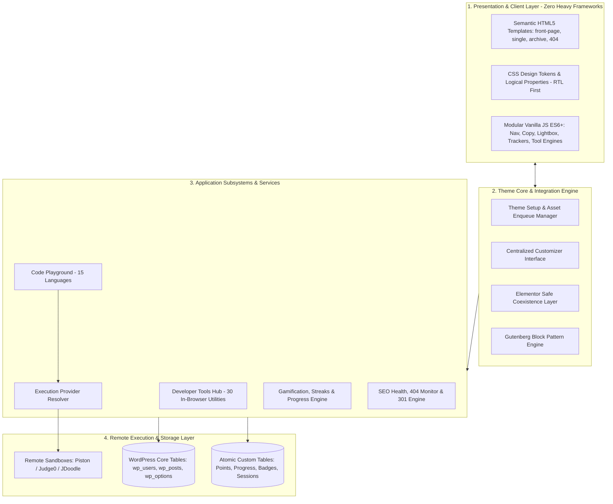

# Code Elta6ur — Proprietary Custom WordPress Theme Engineering Case Study

<p align="center">
  
  
  
  
  
  
  
  
</p>

> **Architectural Documentation & Technical Portfolio**  
> *Engineered & Developed by Mohammad Abu Khashreef for Code Elta6ur.*  
> **Official Platform:** [https://code-elta6ur.com/](https://code-elta6ur.com/)  
> **Developer Website:** [https://mohammad.code-elta6ur.com/](https://mohammad.code-elta6ur.com/)  
> **GitHub:** [https://github.com/mokashreef](https://github.com/mokashreef)  
> 🌐 **Language / اللغة:** [English](README.md) | [العربية](README.ar.md)

---

> [!IMPORTANT]
> **PROPRIETARY & CLOSED-SOURCE CODEBASE NOTICE**  
> This repository is a technical portfolio and engineering case study documenting the architecture, technology stack, design patterns, packaging pipeline, and automated verification behind the custom WordPress theme developed for **Code Elta6ur**.  
> **The original theme source code, implementation files, stylesheets, scripts, database schemas, and operational secrets are strictly proprietary and are intentionally excluded from this repository.**  
> No license to copy, distribute, modify, or use the underlying software is granted or implied. Review [LICENSE](LICENSE) and [docs/ownership-and-license.md](docs/ownership-and-license.md).

---

## Table of Contents
1. [Executive Summary & Business Context](#1-executive-summary--business-context)
2. [Comprehensive Technology Stack & Tools Used](#2-comprehensive-technology-stack--tools-used)
3. [Build Methodology & How We Built It](#3-build-methodology--how-we-built-it)
4. [System Architecture & Layer Decomposition](#4-system-architecture--layer-decomposition)
5. [Core Functional Subsystems](#5-core-functional-subsystems)
   - [A. Developer Tools Hub (30 Special-Purpose Web Utilities)](#a-developer-tools-hub-30-special-purpose-web-utilities)
   - [B. Multi-Language Interactive Code Playground (15 Languages)](#b-multi-language-interactive-code-playground-15-languages)
   - [C. Accounts, Gamification & Learning Progress System](#c-accounts-gamification--learning-progress-system)
   - [D. SEO Health & Traffic Preservation Suite](#d-seo-health--traffic-preservation-suite)
   - [E. Gutenberg Block Patterns & Layout Engine](#e-gutenberg-block-patterns--layout-engine)
6. [Packaging Architecture & Dual-Target Build Pipeline](#6-packaging-architecture--dual-target-build-pipeline)
7. [Release Milestones & Version History](#7-release-milestones--version-history)
8. [Automated Verification, Testing & QA Suite](#8-automated-verification-testing--qa-suite)
9. [Defensive Security & Privacy Architecture](#9-defensive-security--privacy-architecture)
10. [Repository Scope Boundaries](#10-repository-scope-boundaries)
11. [Intellectual Property & Licensing](#11-intellectual-property--licensing)
12. [Attribution & Contact](#12-attribution--contact)

---

## 1. Executive Summary & Business Context

**Code Elta6ur** ([code-elta6ur.com](https://code-elta6ur.com/)) is a premier Arabic educational platform dedicated to software engineering, computer science, and modern web development.

As the platform expanded to hundreds of technical tutorials and thousands of active students, relying on off-the-shelf commercial themes and bloated visual page builders (like Elementor) created severe performance bottlenecks:
- Excessive JavaScript payloads (jQuery, Bootstrap, React bundles) degrading mobile page speeds.
- Deep DOM nesting (15–20 nested `div` containers per section).
- Lack of native, high-performance typography tailored to Arabic developers.
- Fragile plugin dependency chains for developer tools, code sandboxes, and student progress tracking.

To eliminate technical debt and establish an enterprise-grade digital foundation, a bespoke WordPress theme (`code-elta6ur-theme`, v1.2.5) was engineered from scratch. The result is a unified, ultra-lightweight web application disguised as a WordPress theme, operating with zero external heavy frameworks while natively executing complex educational workflows.

---

## 2. Comprehensive Technology Stack & Tools Used

The platform was built strictly according to modern engineering standards, selecting technologies that maximize speed, security, and maintainability:

```
┌────────────────────────────────────────────────────────────────────────┐
│                        CORE TECHNOLOGY STACK                           │
├────────────────────┬───────────────────────────────────────────────────┤
│ Languages          │ • PHP 8.0, 8.1, 8.2, 8.3 (Strict types & WPCS)   │
│                    │ • Vanilla JavaScript (ES6+ Modules, Zero jQuery) │
│                    │ • Modern CSS3 (Grid, Flexbox, Custom Properties)  │
│                    │ • Semantic HTML5 (WCAG 2.1 AA accessible)         │
│                    │ • SQL (MySQL 8.0 / MariaDB 10.6 via dbDelta)     │
│                    │ • Bash / Shell for CLI diagnostics & automation   │
├────────────────────┼───────────────────────────────────────────────────┤
│ WordPress Core     │ • Customizer API (Centralized site-wide settings) │
│ APIs & Frameworks  │ • Rewrite API (Custom permalinks: /tools/, /editor/)│
│                    │ • Transients & Object Cache API (Performance)    │
│                    │ • dbDelta Database API (Atomic custom tables)     │
│                    │ • Block Patterns API (Gutenberg componentization) │
│                    │ • WP-CLI Command API (Headless CLI audit suite)   │
├────────────────────┼───────────────────────────────────────────────────┤
│ Modern Browser     │ • IntersectionObserver API (Lazy-load & reveals)  │
│ Web APIs           │ • Page Visibility API (Active reading tracker)    │
│                    │ • Clipboard API (One-click snippet copy)          │
│                    │ • Web Storage API (Local state & tool caching)    │
├────────────────────┼───────────────────────────────────────────────────┤
│ Remote Sandbox     │ • Piston Runtime Execution Engine                 │
│ Execution Engines  │ • Judge0 API Driver                               │
│                    │ • JDoodle Cloud API Driver                        │
│                    │ • Fallback Null Execution Driver                  │
├────────────────────┼───────────────────────────────────────────────────┤
│ Build, Packaging & │ • Custom PHP ZIP Compiler (build-theme-zip.php)   │
│ Quality Assurance  │ • Standalone CLI Test Runner (run-all-tests.php)  │
│                    │ • PHP Syntax Linter Suite (lint-all-theme.php)    │
│                    │ • Headless Responsive Test Suite (Node.js)        │
│                    │ • Git & GitHub version control (Conventional Commits)│
└────────────────────┴───────────────────────────────────────────────────┘
```

---

## 3. Build Methodology & How We Built It

The engineering workflow followed a disciplined 5-phase development lifecycle:

### Phase 1: Architectural Audit & Domain Modeling
- Analyzed 370+ published articles, 6 multi-part course series, and historical Elementor structures.
- Mapped all permalink patterns and historical 404 access logs to create a definitive URL inventory (`URL-INVENTORY.md`).
- Established the core architectural philosophy: **Zero Heavy Frameworks, Absolute Modularity, and Zero Host Code Execution**.

### Phase 2: Design System & Design Tokens Formulation
- Built a unified Design System (`DESIGN-SYSTEM.md`) in `style.css` using CSS Custom Properties.
- Enforced a strict **"No-Purple"** brand guideline, establishing high-contrast tech blues and cyan accents (`#0170B9`, `#3EA3E8`, `#004A7D`, `#3B82F6`, `#38BDF8`).
- Built all layout grids using **CSS Logical Properties** (`margin-inline`, `padding-inline`, `inset-inline`) to deliver seamless bidirectional Arabic (RTL) and English (LTR) rendering without duplicated CSS files.

### Phase 3: Core Framework & Subsystem Engineering
- Developed the theme bootstrapper (`functions.php`) and modular loader (`inc/`).
- Engineered the **30-tool Developer Hub** with pure client-side execution to guarantee total data privacy.
- Developed the **Multi-Driver Code Execution Sandbox** decoupling the editor frontend from remote runner runtimes via `CDT_Execution_Driver_Interface`.
- Built the **Gamification Engine** with 4 custom database tables created via `dbDelta` and protected by server-side idempotency keys.
- Implemented the **SEO Health Suite** with real-time 404 interception, 301 redirection mapping, and WP-CLI commands.

### Phase 4: Hybrid Coexistence & Legacy Isolation
- Engineered an Elementor compatibility layer (`elementor-compat.css` & `compatibility.php`) that scopes legacy content within `.cdt-has-elementor`, ensuring historical posts render without layout breakage while serving all new pages with clean Gutenberg block patterns.

### Phase 5: Automated Verification & Production Packaging
- Authored automated test runners verifying tool definitions, language runtimes, and static security constraints.
- Developed the dual-target packaging compiler (`build-theme-zip.php`) generating direct WordPress and cPanel deployment archives.

---

## 4. System Architecture & Layer Decomposition

The theme is organized into four distinct architectural layers, ensuring loose coupling and high cohesion:



For detailed architectural diagrams and flowcharts, review [docs/architecture.md](docs/architecture.md).

---

## 5. Core Functional Subsystems

### A. Developer Tools Hub (30 Special-Purpose Web Utilities)
An extensive developer toolset built directly into the theme. All tools process data **100% client-side**, guaranteeing that proprietary source code, credentials, and payloads entered by users never leave their browsers.
- **7 Domains Covered:** JSON & Structured Data (6 tools), Network & API (4 tools), Security & Authentication (5 tools), Text & Regex (2 tools), SQL & Database (3 tools), DevOps & Git (7 tools), CSS & Frontend (3 tools).
- **SEO Permalinks:** Every tool has a dedicated permalink (`/tools/{slug}/`) with custom Schema metadata and acceptance criteria.
- *Detailed specification table available in [docs/features.md](docs/features.md).*

### B. Multi-Language Interactive Code Playground (15 Languages)
An in-lesson code runner allowing students to practice programming directly within course articles:
- **Languages:** Python, JavaScript, TypeScript, C, C++, C#, Java, Go, Rust, PHP, Ruby, Kotlin, Swift, SQL, Bash.
- **Driver Architecture:** Decoupled execution through `CDT_Execution_Driver_Interface`. Supported drivers: Piston, Judge0, JDoodle, and Null Driver.
- **Strict Host Security:** Zero host execution policy. Dynamic code execution functions (`eval`, `exec`, `shell_exec`, `system`, `passthru`) are strictly prohibited and statically validated.
- **SEO Permalinks:** Dedicated language landing pages (`/editor/{lang}/`).

### C. Accounts, Gamification & Learning Progress System
A custom gamification engine integrated directly into WordPress user management:
- **Native Authentication:** Bespoke templates for Login, Registration, Password Recovery, and Member Dashboard without third-party membership plugins.
- **Atomic Points Ledger:** Transactional table (`wp_cdt_points_ledger`) with a unique `idempotency_key` constraint preventing race conditions and replay attacks.
- **Active Reading Tracker:** Leverages Page Visibility API and scroll depth tracking to measure genuine active engagement and reward verified reading milestones.
- **Streaks & Badges:** Automated daily streak tracking with milestone rewards, lesson progress persistence (`wp_cdt_learning_progress`), and 11 distinct achievement badges (`wp_cdt_user_badges`).

### D. SEO Health & Traffic Preservation Suite
- **Real-Time 404 Monitor:** Intercepts 404 errors, recording requested paths, referrers, and user agents.
- **301 Redirection Manager:** Preserves link equity from legacy permalink formats.
- **Granular Indexation & Canonicals:** Automated canonical URLs and selective robots directives (`noindex,follow`) on thin and search query pages.
- **Automated Schema.org JSON-LD:** Structured data generation for articles, breadcrumbs, and educational organizations.
- **Headless WP-CLI Commands:** Custom command `wp cdt-seo audit` for command-line diagnostics.

### E. Gutenberg Block Patterns & Layout Engine
- Custom pattern category: **Code Elta6ur Patterns**.
- Production-ready block assemblies: Responsive heroes, course grids, feature highlights, and interactive CTAs.
- Completely removes dependency on page builders for all ongoing content publishing.

---

## 6. Packaging Architecture & Dual-Target Build Pipeline

To eliminate manual deployment errors, the project includes an automated packaging script (`build-theme-zip.php`) that compiles two specialized deployment packages:

```
[Theme Source: code-elta6ur-theme/]
        │
        ├──> build-theme-zip.php
        │         │
        │         ├──> Target 1: code-elta6ur-theme.zip (WP-Admin Direct Upload)
        │         │    • Root-level files with priority header indexing (style.css, functions.php)
        │         │    • Ready for Appearance -> Themes -> Upload Theme
        │         │
        │         └──> Target 2: code-elta6ur-theme-cpanel.zip (Server File Manager)
        │              • Directory-wrapped structure (code-elta6ur-theme/...)
        │              • Ready for cPanel / SSH extraction into wp-content/themes/
```

- **Clean Distribution Hygiene:** All version control metadata (`.git`), tests (`tests/`), scratch scripts, and development markdown files are automatically excluded from the distribution archives.
- **Integrity Validation:** Validated via automated script `test-zip-integrity.php`.
- *Full packaging details available in [docs/releases-and-packaging.md](docs/releases-and-packaging.md).*

---

## 7. Release Milestones & Version History

| Release Tag | Milestone Focus | Status | Key Deliverables |
| :---: | :--- | :---: | :--- |
| **v1.2.5** | **Developer Tools & Multi-Language Sandbox** | **Current Production** | 30 client-side tools, 15-language code runner, driver resolver architecture, zero host code execution. |
| **v1.2.0** | **Gamification & Learning Progress System** | Released | Native accounts, atomic points ledger, active reading tracker, daily streaks, 11 badges. |
| **v1.1.0** | **SEO Health & Traffic Protection Suite** | Released | Real-time 404 monitor, 301 redirection engine, Schema.org JSON-LD, WP-CLI diagnostics. |
| **v1.0.0** | **Core Theme & Design System Foundation** | Released | Zero-framework Vanilla JS core, CSS design tokens, RTL-first layout, Gutenberg patterns, Elementor wrapper. |

*Review complete release notes in [docs/releases-and-packaging.md](docs/releases-and-packaging.md).*

---

## 8. Automated Verification, Testing & QA Suite

Quality assurance is enforced through standalone automated verification suites:

- **Automated Test Runner (`run-all-tests.php`):** Standalone PHP CLI suite testing tool registries, runtime configs, driver resolution, and schema conformance.
- **Static Security Audits:** Automated directory scans enforcing zero local dynamic execution calls (`eval`, `exec`, `shell_exec`, `system`, `passthru`).
- **PHP Syntax & WPCS Linting:** 100% PHP 8.0-8.3 syntax compliance across all theme files.
- **DOM & Responsive Testing (`test-responsive-suite.js`):** Headless browser validation across mobile (`375px`), tablet (`768px`), and desktop (`1440px`) viewports.
- **Production Package Integrity:** Automated verification of ZIP file structure and asset inclusion.
- *Detailed test coverage documentation available in [docs/testing-and-qa.md](docs/testing-and-qa.md).*

---

## 9. Defensive Security & Privacy Architecture

1. **Zero Host Execution:** Interactive code playground proxies execution to external sandboxed containers. No user code is ever executed on the WordPress server.
2. **Zero-Trust Client Data:** Point rewards and progress milestones are validated and calculated exclusively on the server.
3. **Transactional Idempotency:** Points ledger uses database-enforced unique idempotency keys, eliminating race conditions and duplicate crediting.
4. **Comprehensive Data Sanitization:** All inputs sanitized (`sanitize_text_field`, `sanitize_email`); all outputs contextually escaped (`esc_html`, `esc_attr`, `wp_kses_post`).
5. **Client-Side Privacy:** Developer tools process JSON, SQL, JWTs, and regex queries strictly within the user's browser memory.

---

## 10. Repository Scope Boundaries

| Category | In This Repository | Excluded from Repository |
| :--- | :---: | :---: |
| **Architecture & Design Models** | Yes | — |
| **Technical Specifications** | Yes | — |
| **Engineering Decisions (ADRs)** | Yes | — |
| **Release & Packaging Specifications** | Yes | — |
| **Feature Inventories & Capabilities** | Yes | — |
| **Testing & QA Methodologies** | Yes | — |
| **Proprietary Source Code (PHP/JS/CSS)** | — | **Excluded (Proprietary)** |
| **Database Schemas & Production Dumps** | — | **Excluded (Private)** |
| **API Keys, Secrets & Credentials** | — | **Excluded (Confidential)** |
| **Operational & Server Infrastructure** | — | **Excluded (Confidential)** |

Review full boundary definitions in [docs/project-scope.md](docs/project-scope.md).

---

## 11. Intellectual Property & Licensing

All original documentation, architecture models, technical specifications, and portfolio materials contained in this repository are:

**Copyright (c) 2026 Mohammad Abu Khashreef. All rights reserved.**

Developed exclusively for **Code Elta6ur** ([code-elta6ur.com](https://code-elta6ur.com/)).

This repository does **not** grant or imply any license to copy, distribute, modify, or use the proprietary Code Elta6ur WordPress theme, its source code, compiled assets, or operational databases. For legal terms, review [LICENSE](LICENSE) and [docs/ownership-and-license.md](docs/ownership-and-license.md).

---

## 12. Attribution & Contact

- **Lead Engineer & Architect:** Mohammad Abu Khashreef
- **Platform:** [Code Elta6ur (كود التطور)](https://code-elta6ur.com/)
- **Developer Website:** [https://mohammad.code-elta6ur.com/](https://mohammad.code-elta6ur.com/)
- **GitHub Profile:** [https://github.com/mokashreef](https://github.com/mokashreef)