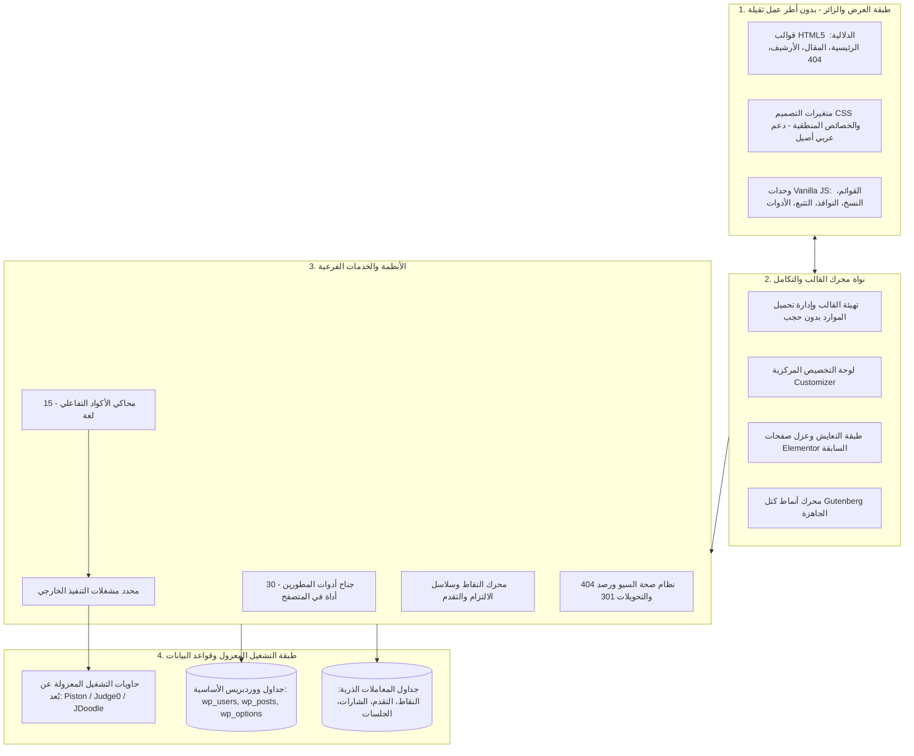
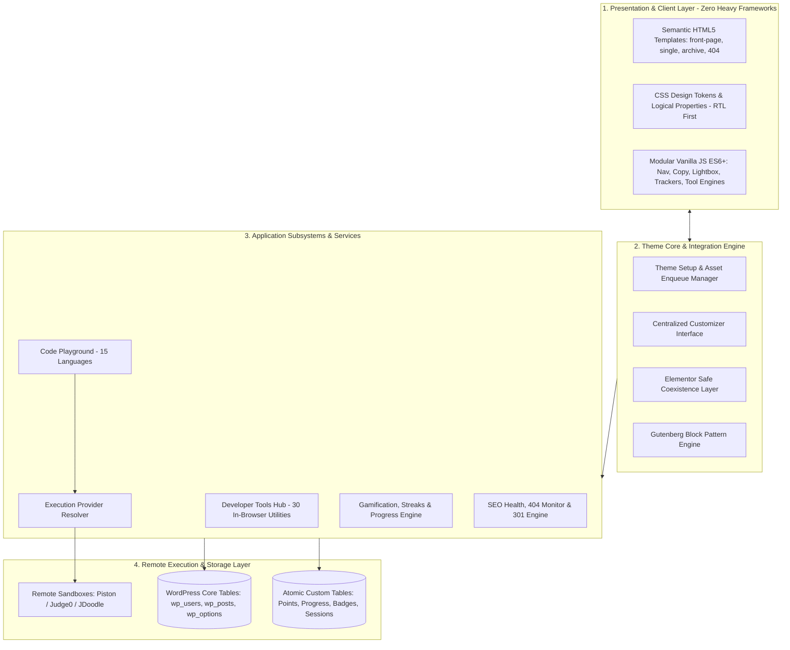

# كود التطور | Code Elta6ur — Custom WordPress Theme Engineering Case Study

<p align="center">
  
  
  
  
  
  
  
  
</p>

---

<div align="center">
  <h3>🌐 اختر لغة التوثيق / Select Documentation Language</h3>
  <p>
    <a href="#-النسخة-العربية-المعتمدة--arabic-documentation"></a>
    &nbsp;&nbsp;&nbsp;&nbsp;
    <a href="#-english-version--technical-case-study"></a>
  </p>
  <p>
    <em>يتوفر هذا التوثيق كاملاً باللغتين العربية والإنجليزية في هذه الصفحة، وكذلك كملفات منفصلة: <a href="README.ar.md">README.ar.md</a> | <a href="README.md">README.md</a></em>
  </p>
</div>

---

> [!IMPORTANT]
> **إشعار الملكية الفكرية والبرمجيات الخاصة | PROPRIETARY & CLOSED-SOURCE NOTICE**  
> هذا المستودع عبارة عن معرض أعمال تقني ودراسة حالة معمارية توثق التصميم الهندسي لقالب ووردبريس المطور حصرياً لصالح **منصة كود التطور**. الشيفرة المصدرية الأصلية للقالب وملفات تنفيذه وأسراره التشغيلية هي ملكية خاصة تماماً ومستبعدة عمداً من هذا المستودع.  
> *This repository is a technical portfolio and engineering case study documenting the architecture behind the custom WordPress theme for **Code Elta6ur**. Source code and implementation files are strictly proprietary and excluded.*

---

# 🇸🇦 النسخة العربية المعتمدة | Arabic Documentation

> **توثيق معماري شامل ومعرض أعمال تقني**  
> *هندسة وتطوير: م. محمد أبو خشريف لصالح منصة كود التطور التعليمية.*  
> **المنصة الرسمية:** [https://code-elta6ur.com/](https://code-elta6ur.com/)  
> **موقع المطور التعريفي:** [https://mohammad.code-elta6ur.com/](https://mohammad.code-elta6ur.com/)  
> **حساب GitHub:** [https://github.com/mokashreef](https://github.com/mokashreef)  
> 📄 **ملف التوثيق العربي المنفصل:** [README.ar.md](README.ar.md) | 🇬🇧 [الانتقال للإنجليزية](#-english-version--technical-case-study)

## فهرس المحتويات (العربية)
1. [الملخص التنفيذي وسياق المشروع](#1-الملخص-التنفيذي-وسياق-المشروع)
2. [حزمة التقنيات الشاملة والأدوات المستخدمة](#2-حزمة-التقنيات-الشاملة-والأدوات-المستخدمة)
3. [منهجية البناء وكيف تم التطوير خطوة بخطوة](#3-منهجية-البناء-وكيف-تم-التطوير-خطوة-بخطوة)
4. [معمارية النظام وتفكيك الطبقات الهندسية](#4-معمارية-النظام-وتفكيك-الطبقات-الهندسية)
5. [الأنظمة والأجنحة الوظيفية الرئيسية](#5-الأنظمة-والأجنحة-الوظيفية-الرئيسية)
6. [معمارية التحزيم الآلي وحزم التوزيع المزدوجة](#6-معمارية-التحزيم-الآلي-وحزم-التوزيع-المزدوجة)
7. [سجل الإصدارات التاريخية والمحطات الهندسية](#7-سجل-الإصدارات-التاريخية-والمحطات-الهندسية)
8. [منظومة التحقق المؤتمت والاختبارات وضمان الجودة](#8-منظومة-التحقق-المؤتمت-والاختبارات-وضمان-الجودة)
9. [معمارية الأمان الدفاعي وحماية الخصوصية](#9-معمارية-الأمان-الدفاعي-وحماية-الخصوصية)
10. [نطاق وحدود المستودع المعتمدة](#10-نطاق-وحدود-المستودع-المعتمدة)
11. [الملكية الفكرية وشروط الترخيص والاستخدام](#11-الملكية-الفكرية-وشروط-الترخيص-والاستخدام)

---

### 1. الملخص التنفيذي وسياق المشروع

**منصة كود التطور** ([code-elta6ur.com](https://code-elta6ur.com/)) هي صرح تعليمي عربي رائد متخصص في علوم الحاسوب وهندسة البرمجيات وتطوير الويب بمختلف مساراته.

مع نمو المنصة لتضم مئات المقالات التقنية و6 سلاسل برمجية متكاملة وآلاف الطلاب، واجه الموقع قيوداً شديدة نتيجة الاعتماد السابق على القوالب التجارية الجاهزة وبناة الصفحات الثقيلة (مثل Elementor):
- بطء ملحوظ في سرعة التحميل على الهواتف الذكية نتيجة تضخم ملفات JavaScript (jQuery, Bootstrap, React).
- تداخل عميق في شجرة عناصر الـ DOM (تصل إلى 15–20 حاوية متداخلة للقسم الواحد).
- غياب تايبوجرافي عربي أصيل موجه للمبرمجين العرب مع دعم الـ RTL المتوازن.
- تضارب الإضافات الخارجية وتعطيلها المستمر لميزات محاكي الأكواد وتتبع تقدم الطلاب.

لتجاوز هذا العبء التقني، تم اتخاذ قرار هندسي استراتيجي بإنشاء قالب ووردبريس مخصص بالكامل من الصفر (`code-elta6ur-theme`، الإصدار 1.2.5). القالب بمثابة تطبيق ويب متكامل فائق الخفة مدمج بذكاء داخل نواة ووردبريس، يعمل باستقلالية تامة وبدون أي أطر عمل ثقيلة في الواجهة، ليقدم أداءً قياسياً وتجربة تعليمية عربية استثنائية.

---

### 2. حزمة التقنيات الشاملة والأدوات المستخدمة

```
┌────────────────────────────────────────────────────────────────────────┐
│                        مصفوفة التقنيات والأدوات المعتمدة                │
├────────────────────┬───────────────────────────────────────────────────┤
│ لغات البرمجة       │ • PHP 8.0, 8.1, 8.2, 8.3 (أنواع صريحة ومعايير WPCS)│
│                    │ • Vanilla JavaScript (ES6+ Modules، صفر jQuery)   │
│                    │ • Modern CSS3 (Grid, Flexbox, Custom Properties)  │
│                    │ • Semantic HTML5 (مطابق لمعايير WCAG 2.1 AA)     │
│                    │ • SQL (MySQL 8.0 / MariaDB عبر آلية dbDelta)      │
│                    │ • Bash / Shell للسكربتات وفحوصات الـ CLI          │
├────────────────────┼───────────────────────────────────────────────────┤
│ واجهات ونواة       │ • Customizer API (إدارة مركزية شاملة لكافة الإعدادات)│
│ ووردبريس الرسمية   │ • Rewrite API (مسارات مخصصة للأدوات /tools/ والمحرر)│
│                    │ • Transients & Object Cache API (أعلى كفاءة كاش)  │
│                    │ • dbDelta Database API (إنشاء الجداول المخصصة)     │
│                    │ • Block Patterns API (أنماط كتل Gutenberg الأصلية) │
│                    │ • WP-CLI Command API (أوامر سطر أوامر مخصصة للسيو)│
├────────────────────┼───────────────────────────────────────────────────┤
│ واجهات المتصفح     │ • IntersectionObserver API (التحميل الكسول والتحريك)│
│ الحديثة (Web APIs) │ • Page Visibility API (متتبع القراءة النشطة الفعلي) │
│                    │ • Clipboard API (نسخ الأكواد البرمجية بنقرة واحدة) │
│                    │ • Web Storage API (حفظ تفضيلات الأدوات في المتصفح) │
├────────────────────┼───────────────────────────────────────────────────┤
│ محركات تشغيل       │ • Piston Execution Engine Driver                  │
│ الأكواد المعزولة   │ • Judge0 API Driver                               │
│                    │ • JDoodle Cloud API Driver                        │
│                    │ • مشغل الأمان الاحتياطي (Null Execution Driver)   │
├────────────────────┼───────────────────────────────────────────────────┤
│ أدوات البناء       │ • مجمع التحزيم المخصص (build-theme-zip.php)        │
│ والتحقق والجودة    │ • مشغل الاختبارات المستقل (run-all-tests.php)      │
│                    │ • فاحص التوافق النحوي الشامل (lint-all-theme.php) │
│                    │ • فاحص التجاوب البصري المؤتمت (Node.js)           │
│                    │ • نظام إدارة النسخ Git مع معايير Conventional Commits│
└────────────────────┴───────────────────────────────────────────────────┘
```

---

### 3. منهجية البناء وكيف تم التطوير خطوة بخطوة

1. **الفحص والتحليل ونمذجة النطاق:** حصر مسارات الموقع التاريخية الـ 370 وتحديد قيود الأداء.
2. **صياغة نظام التصميم ومحددات الهوية (Design Tokens):** الالتزام بسياسة "حظر البنفسجي"، واعتماد الخصائص المنطقية في CSS لدعم العربية والإنجليزية دون تكرار الأنماط.
3. **هندسة المحركات والأنظمة الفرعية:** بناء جناح الـ 30 أداة، ومحاكي الـ 15 لغة، ونظام التحفيز الذري المحمي بـ `idempotency_key`، وجناح السيو.
4. **التعايش السلمي وعزل صفحات Elementor السابقة:** عزل الصفحات القديمة دون تشويهها مع خدمة الصفحات الجديدة بأنماط Gutenberg الخفيفة.
5. **التحقق المؤتمت وبناء حزم الإنتاج:** الاختبارات التلقائية الشاملة وتجريد حزم النشر من ملفات التطوير.

---

### 4. معمارية النظام وتفكيك الطبقات الهندسية



للاطلاع على تفاصيل المعمارية بالعربية: [docs/ar/architecture.md](docs/ar/architecture.md).

---

### 5. الأنظمة والأجنحة الوظيفية الرئيسية

- **جناح أدوات المطورين (30 أداة):** يعمل 100% من جانب العميل لحماية الخصوصية عبر 7 مجالات (بيانات JSON، شبكات API، أمان ومصادقة، نصوص Regex، قواعد بيانات SQL، أدوات DevOps، وتنسيقات CSS). تفاصيل الأدوات: [docs/ar/features.md](docs/ar/features.md).
- **محاكي الأكواد التفاعلي (15 لغة):** بيئة آمنة تعتمد مشغلات خارجية معزولة (Piston, Judge0, JDoodle, Null) مع انعدام تام للتنفيذ المحلي على الخادم.
- **نظام العضويات والتحفيز:** سجل نقاط ذري غير قابل للتكرار (`wp_cdt_points_ledger`)، متتبع القراءة النشطة عبر Page Visibility API، وسلاسل الالتزام، و11 شارة معتمدة.
- **جناح صحة الـ SEO:** رصد فوري لأخطاء 404، محرك تحويلات 301، بيانات Schema.org JSON-LD، وأوامر WP-CLI.
- **أنماط Gutenberg الجاهزة:** تصنيف خاص بأنماط كود التطور يغني تماماً عن بناة الصفحات.

---

### 6. معمارية التحزيم الآلي وحزم التوزيع المزدوجة

- **الحزمة الأولى (`code-elta6ur-theme.zip`):** مخصصة للرفع المباشر عبر لوحة تحكم ووردبريس (`المظهر -> قوالب -> رفع قالب`) مع أولوية فهرسة الترويسات.
- **الحزمة الثانية (`code-elta6ur-theme-cpanel.zip`):** مخصصة لمدراء النظم ومرفوعة داخل مجلد مغلف جاهز لفك الضغط المباشر داخل `wp-content/themes/`.
- توثيق التحزيم الكامل: [docs/ar/releases-and-packaging.md](docs/ar/releases-and-packaging.md).

---

### 7. سجل الإصدارات التاريخية والمحطات الهندسية

| وسم الإصدار | المحور المعماري | الحالة | أبرز المخرجات الهندسية |
| :---: | :--- | :---: | :--- |
| **v1.2.5** | **أدوات المطورين ومحاكي الأكواد** | **الإنتاج الحالي** | 30 أداة ويب متخصصة، محاكي 15 لغة، نمط المشغلات المعزولة، أمان الخادم التام. |
| **v1.2.0** | **نظام التحفيز والعضويات والتقدم** | تم الإطلاق | لوحة العضوية، سجل النقاط الذري، متتبع القراءة النشطة، سلاسل الالتزام، 11 شارة. |
| **v1.1.0** | **جناح صحة السيو والأرشفة** | تم الإطلاق | رصد أخطاء 404، محرك تحويلات 301، بيانات Schema.org JSON-LD، أوامر WP-CLI. |
| **v1.0.0** | **القالب الأساسي ونظام التصميم** | تم الإطلاق | معمارية Vanilla JS النقية، متغيرات التصميم CSS، دعم RTL أصيل، أنماط Gutenberg، غلاف Elementor. |

---

### 8. منظومة التحقق المؤتمت والاختبارات وضمان الجودة
- مشغل الاختبارات المستقل `run-all-tests.php`.
- المسح الأمني الثابت ضد دوال التنفيذ الخطرة.
- فحص التوافق النحوي الشامل لـ PHP 8.0-8.3 ومعايير WPCS.
- فحص التجاوب البصري `test-responsive-suite.js` ومطابقة تباين الألوان مع WCAG 2.1 AA.
- التفاصيل الكاملة: [docs/ar/testing-and-qa.md](docs/ar/testing-and-qa.md).

---

### 9. معمارية الأمان الدفاعي وحماية الخصوصية
- انعدام التنفيذ المحلي للأكواد على خادم الاستضافة (Zero Host Execution).
- انعدام الثقة في بيانات المتصفح وإجراء كافة الحسابات الحساسة على الخادم (Zero-Trust).
- قيود فريدة لمنع تكرار المعاملات وسباق الطلبات (Idempotency).
- تعقيم وتطهير شامل لكافة المدخلات والمخرجات.
- التفاصيل الكاملة: [docs/ar/security-and-privacy.md](docs/ar/security-and-privacy.md).

---

### 10. نطاق وحدود المستودع المعتمدة
- **المشمول:** المعمارية، المواصفات، سجلات ADRs، منهجيات الاختبارات، والتحزيم.
- **المستبعد بصرامة:** الشيفرة المصدرية للقالب (PHP/JS/CSS)، قواعد البيانات، مفاتيح الـ API، والأسرار.
- التفاصيل الكاملة: [docs/ar/project-scope.md](docs/ar/project-scope.md).

---

### 11. الملكية الفكرية وشروط الترخيص والاستخدام
جميع مواد التوثيق ومعرض الأعمال والمواصفات الفنية المنشورة في هذا المستودع **محفوظة الحقوق © 2026 م. محمد أبو خشريف. كافة الحقوق محفوظة.**  
هذا المستودع لا يمنح أي ترخيص باستخدام القالب الخاص أو شيفرته. التفاصيل: [docs/ar/ownership-and-license.md](docs/ar/ownership-and-license.md) و [LICENSE](LICENSE).

---

<br><br>

---

# 🇬🇧 English Version | Technical Case Study

> **Architectural Documentation & Technical Portfolio**  
> *Engineered & Developed by Mohammad Abu Khashreef for Code Elta6ur.*  
> **Official Platform:** [https://code-elta6ur.com/](https://code-elta6ur.com/)  
> **Developer Website:** [https://mohammad.code-elta6ur.com/](https://mohammad.code-elta6ur.com/)  
> **GitHub:** [https://github.com/mokashreef](https://github.com/mokashreef)  
> 📄 **Standalone Arabic Documentation:** [README.ar.md](README.ar.md) | 🇸🇦 [Jump to Arabic Section](#-النسخة-العربية-المعتمدة--arabic-documentation)

## Table of Contents (English)
1. [Executive Summary & Business Context](#1-executive-summary--business-context)
2. [Comprehensive Technology Stack & Tools Used](#2-comprehensive-technology-stack--tools-used)
3. [Build Methodology & How We Built It](#3-build-methodology--how-we-built-it)
4. [System Architecture & Layer Decomposition](#4-system-architecture--layer-decomposition)
5. [Core Functional Subsystems](#5-core-functional-subsystems)
6. [Packaging Architecture & Dual-Target Build Pipeline](#6-packaging-architecture--dual-target-build-pipeline)
7. [Release Milestones & Version History](#7-release-milestones--version-history)
8. [Automated Verification, Testing & QA Suite](#8-automated-verification-testing--qa-suite)
9. [Defensive Security & Privacy Architecture](#9-defensive-security--privacy-architecture)
10. [Repository Scope Boundaries](#10-repository-scope-boundaries)
11. [Intellectual Property & Licensing](#11-intellectual-property--licensing)
12. [Attribution & Contact](#12-attribution--contact)

---

### 1. Executive Summary & Business Context

**Code Elta6ur** ([code-elta6ur.com](https://code-elta6ur.com/)) is a premier Arabic educational platform dedicated to software engineering, computer science, and modern web development.

As the platform expanded to hundreds of technical tutorials and thousands of active students, relying on off-the-shelf commercial themes and bloated visual page builders (like Elementor) created severe performance bottlenecks:
- Excessive JavaScript payloads (jQuery, Bootstrap, React bundles) degrading mobile page speeds.
- Deep DOM nesting (15–20 nested `div` containers per section).
- Lack of native, high-performance typography tailored to Arabic developers.
- Fragile plugin dependency chains for developer tools, code sandboxes, and student progress tracking.

To eliminate technical debt and establish an enterprise-grade digital foundation, a bespoke WordPress theme (`code-elta6ur-theme`, v1.2.5) was engineered from scratch. The result is a unified, ultra-lightweight web application disguised as a WordPress theme, operating with zero external heavy frameworks while natively executing complex educational workflows.

---

### 2. Comprehensive Technology Stack & Tools Used

```
┌────────────────────────────────────────────────────────────────────────┐
│                        CORE TECHNOLOGY STACK                           │
├────────────────────┬───────────────────────────────────────────────────┤
│ Languages          │ • PHP 8.0, 8.1, 8.2, 8.3 (Strict types & WPCS)   │
│                    │ • Vanilla JavaScript (ES6+ Modules, Zero jQuery) │
│                    │ • Modern CSS3 (Grid, Flexbox, Custom Properties)  │
│                    │ • Semantic HTML5 (WCAG 2.1 AA accessible)         │
│                    │ • SQL (MySQL 8.0 / MariaDB 10.6 via dbDelta)     │
│                    │ • Bash / Shell for CLI diagnostics & automation   │
├────────────────────┼───────────────────────────────────────────────────┤
│ WordPress Core     │ • Customizer API (Centralized site-wide settings) │
│ APIs & Frameworks  │ • Rewrite API (Custom permalinks: /tools/, /editor/)│
│                    │ • Transients & Object Cache API (Performance)    │
│                    │ • dbDelta Database API (Atomic custom tables)     │
│                    │ • Block Patterns API (Gutenberg componentization) │
│                    │ • WP-CLI Command API (Headless CLI audit suite)   │
├────────────────────┼───────────────────────────────────────────────────┤
│ Modern Browser     │ • IntersectionObserver API (Lazy-load & reveals)  │
│ Web APIs           │ • Page Visibility API (Active reading tracker)    │
│                    │ • Clipboard API (One-click snippet copy)          │
│                    │ • Web Storage API (Local state & tool caching)    │
├────────────────────┼───────────────────────────────────────────────────┤
│ Remote Sandbox     │ • Piston Runtime Execution Engine                 │
│ Execution Engines  │ • Judge0 API Driver                               │
│                    │ • JDoodle Cloud API Driver                        │
│                    │ • Fallback Null Execution Driver                  │
├────────────────────┼───────────────────────────────────────────────────┤
│ Build, Packaging & │ • Custom PHP ZIP Compiler (build-theme-zip.php)   │
│ Quality Assurance  │ • Standalone CLI Test Runner (run-all-tests.php)  │
│                    │ • PHP Syntax Linter Suite (lint-all-theme.php)    │
│                    │ • Headless Responsive Test Suite (Node.js)        │
│                    │ • Git & GitHub version control (Conventional Commits)│
└────────────────────┴───────────────────────────────────────────────────┘
```

---

### 3. Build Methodology & How We Built It

1. **Architectural Audit & Domain Modeling:** Audited 370+ posts, 6 courses, and historical URLs to establish the URL inventory (`URL-INVENTORY.md`).
2. **Design Tokens & System Construction:** Created design tokens in `style.css` using CSS Custom Properties and enforced the "No-Purple" rule (`#0170B9`, `#3EA3E8`, `#004A7D`, `#3B82F6`, `#38BDF8`). Adopted CSS Logical Properties for native bidirectional RTL/LTR support.
3. **Core Subsystems Engineering:** Developed the 30-tool Developer Hub (client-side execution), 15-language Code Playground (multi-driver architecture), Gamification Engine (idempotent points ledger, active reading tracker), and SEO Health Suite.
4. **Hybrid Coexistence & Isolation:** Implemented the Elementor compatibility layer (`elementor-compat.css` & `compatibility.php`) to isolate legacy content without polluting new Gutenberg block patterns.
5. **Automated Verification & Packaging:** Built automated CLI test runners and the dual-target packaging compiler (`build-theme-zip.php`).

---

### 4. System Architecture & Layer Decomposition



Full architecture specifications: [docs/architecture.md](docs/architecture.md).

---

### 5. Core Functional Subsystems

- **Developer Tools Hub (30 Utilities):** Operates 100% client-side across 7 categories (JSON, APIs, Security, Regex, SQL, DevOps, CSS). Detailed inventory: [docs/features.md](docs/features.md).
- **Multi-Language Interactive Code Playground (15 Languages):** Decoupled execution through `CDT_Execution_Driver_Interface`. Remote sandbox containers with Zero Host Execution security.
- **Accounts & Gamification Engine:** Native accounts, atomic points ledger (`wp_cdt_points_ledger`) with database idempotency keys, active reading tracker with Page Visibility API, streaks, and 11 badges.
- **SEO Health Suite:** Real-time 404 monitoring, 301 redirection engine, Schema.org JSON-LD, and WP-CLI diagnostic commands.
- **Gutenberg Block Pattern Engine:** Native reusable block patterns eliminating page builders.

---

### 6. Packaging Architecture & Dual-Target Build Pipeline

- **Target 1 (`code-elta6ur-theme.zip`):** Direct upload package for `Appearance -> Themes -> Add New -> Upload Theme` with priority header indexing (`style.css`, `functions.php`).
- **Target 2 (`code-elta6ur-theme-cpanel.zip`):** Directory-wrapped package (`code-elta6ur-theme/...`) for cPanel File Manager or SSH extraction into `wp-content/themes/`.
- Full packaging guide: [docs/releases-and-packaging.md](docs/releases-and-packaging.md).

---

### 7. Release Milestones & Version History

| Release Tag | Milestone Focus | Status | Key Deliverables |
| :---: | :--- | :---: | :--- |
| **v1.2.5** | **Developer Tools & Multi-Language Sandbox** | **Current Production** | 30 client-side tools, 15-language code runner, driver resolver architecture, zero host code execution. |
| **v1.2.0** | **Gamification & Learning Progress System** | Released | Native accounts, atomic points ledger, active reading tracker, daily streaks, 11 badges. |
| **v1.1.0** | **SEO Health & Traffic Protection Suite** | Released | Real-time 404 monitor, 301 redirection engine, Schema.org JSON-LD, WP-CLI diagnostics. |
| **v1.0.0** | **Core Theme & Design System Foundation** | Released | Zero-framework Vanilla JS core, CSS design tokens, RTL-first layout, Gutenberg patterns, Elementor wrapper. |

---

### 8. Automated Verification, Testing & QA Suite
- Automated CLI Test Runner: `run-all-tests.php`.
- Static Security Scans: 0 calls to dynamic evaluation functions (`eval`, `exec`, `shell_exec`, `system`).
- PHP Syntax Linting: 100% compliance across PHP 8.0-8.3 and WPCS.
- DOM & Responsive Testing: Viewport validation across mobile (`375px`), tablet (`768px`), and desktop (`1440px`).
- Detailed QA documentation: [docs/testing-and-qa.md](docs/testing-and-qa.md).

---

### 9. Defensive Security & Privacy Architecture
- Zero Host Execution: Untrusted student code is never evaluated on the WordPress server.
- Zero-Trust Client Data: All point calculations occur server-side.
- Transactional Idempotency: Enforced by unique database constraints.
- Full security documentation: [docs/security-and-privacy.md](docs/security-and-privacy.md).

---

### 10. Repository Scope Boundaries
- **In-Scope:** Architectural designs, specifications, ADRs, QA methodologies, packaging designs.
- **Excluded:** Theme source code (PHP/JS/CSS), database dumps, API credentials, server configurations.
- Scope definition: [docs/project-scope.md](docs/project-scope.md).

---

### 11. Intellectual Property & Licensing
All original documentation, specifications, and architecture models are **Copyright (c) 2026 Mohammad Abu Khashreef. All rights reserved.**  
This repository does not grant any license to the proprietary theme. Review [LICENSE](LICENSE) and [docs/ownership-and-license.md](docs/ownership-and-license.md).

---

### 12. Attribution & Contact

- **Lead Engineer & Architect:** Mohammad Abu Khashreef
- **Platform:** [Code Elta6ur (كود التطور)](https://code-elta6ur.com/)
- **Developer Website:** [https://mohammad.code-elta6ur.com/](https://mohammad.code-elta6ur.com/)
- **GitHub Profile:** [https://github.com/mokashreef](https://github.com/mokashreef)