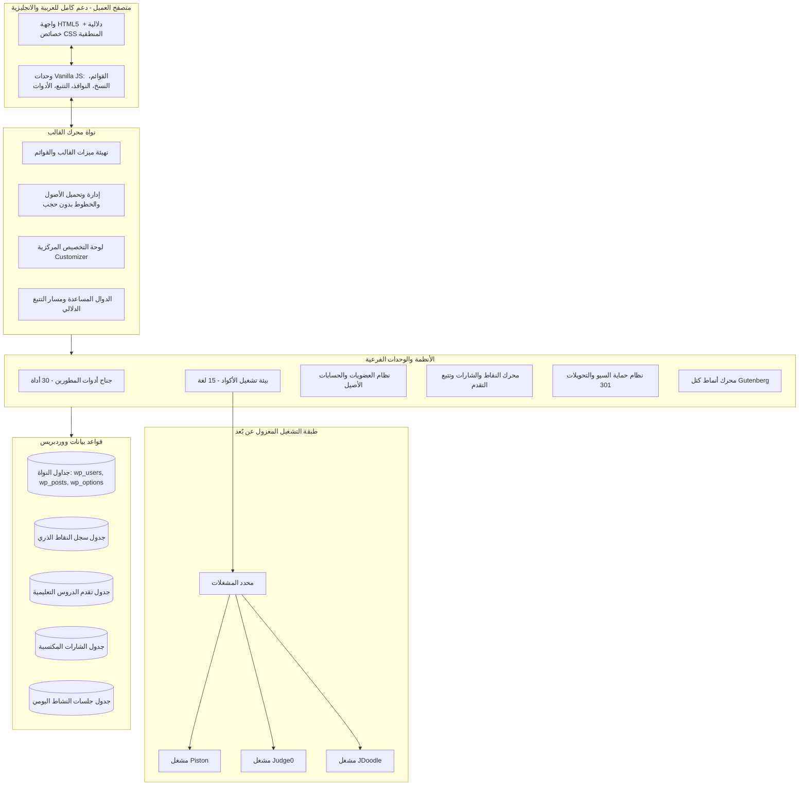

# المعمارية الشاملة وهندسة النظام — قالب كود التطور
> 🌐 **اللغة / Language:** [العربية](architecture.md) | [English](../architecture.md)

توضح هذه الوثيقة المعمارية الهندسية، وأنماط التصميم، وفصل المسؤوليات، وتدفق البيانات داخل قالب ووردبريس المخصص لمنصة **كود التطور**.

---

## 1. الفلسفة المعمارية للقالب

تستند معمارية القالب إلى 4 ركائز هندسية غير قابلة للمساومة:

1. **الاستقلالية وعدم التبعية (Zero Heavy Frameworks):**
   رفض التوجه الشائع بتضمين jQuery أو Bootstrap أو مكتبات الواجهات الثقيلة في واجهة زوار الموقع. جميع التفاعلات مبنية على Vanilla JavaScript (ES6+) واستغلال واجهات المتصفح الحديثة.
2. **المركزية في الإدارة والتكوين:**
   منع أي نصوص أو روابط أو بيانات ثابتة (Hardcoded) في القالب؛ جميع الروابط، وأرقام التواصل، والشبكات الاجتماعية، والـ CTA تدار مركزياً عبر WordPress Customizer.
3. **التضمين عبر كتل Gutenberg الأصلية:**
   الاعتماد على أنماط الكتل الأصلية (Block Patterns) بدلاً من أدوات بناء الصفحات الخارجية، لضمان أعلى سرعة وتحقيق شفرة HTML5 دلالية خفيفة.
4. **الأمان المتعدد الطبقات:**
   تعقيم المدخلات الصارم، والهروب السياقي لجميع المخرجات، والتحقق من الرموز الأمنية (Nonces) في كافة الطلبات الحساسة، وعزل بيئات تشغيل الأكواد.

---

## 2. مخطط معمارية النظام الميداني

---

## 3. تفكيك وهيكلة المكونات

### أ) طبقة العرض والقوالب
- **القوالب الرئيسية:** قوالب قياسية تغطي الصفحة الرئيسية، والمقالات، والصفحات العامة، والأرشيفات، والبحث، وصفحة 404.
- **أجزاء القوالب المعيارية (Template Parts):**
  - ترويسة الموقع والقوائم المتجاوبة للهواتف.
  - تذييل الموقع وأعمدة الفوتر المتعددة وبيانات الحقوق.
  - بانرات الهيرو الترحيبية والتوجيهية.
  - بطاقات المقالات والكورسات والفيديوهات والمميزات.
  - جسم المحتوى مع مسار التنقل الدلالي ومؤشرات وقت القراءة وأزرار نسخ الأكواد.

### ب) طبقة الأنظمة الفرعية
1. **جناح أدوات المطورين:** يعمل بالكامل من جانب العميل لضمان عدم إرسال بيانات المستخدم أو أسراره لخوادم خارجية.
2. **محاكي الأكواد البرمجية:** يعتمد نمط الواجهة والمحدد (Resolver Pattern) لعزل بيئات التشغيل وضمان عدم تنفيذ أي سطر كود على الخادم المضيف.
3. **نظام العضويات والتحفيز:** يمتد بسلاسة فوق جدول مستخدمي ووردبريس دون تشويه، ويعتمد مفاتيح منع التكرار لحماية سلامة المعاملات.
4. **جناح السيو والأرشفة:** رصد آني لأخطاء 404، ومعالجة تلقائية للتحويلات 301، وبيانات Schema.org المنظمة.

### ج) طبقة التوافق والتعايش السلمي
- عزل صفحات Elementor السابقة داخل كلاسات محددة النطاق لمنع تشوه التصميم، مع بناء الصفحات الجديدة بأنماط كتل أصلية خفيفة.